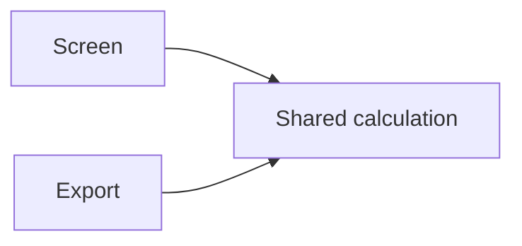

# Coding Practices

Make code easier to understand and change correctly, with clear responsibilities and an authoritative owner for each concept.

This agent skill guides implementation, refactoring, and code review across programming languages. It gives particular attention to **separation of concerns** and **single source of truth**, while adapting decisions to the project and the size of the change.

## What it helps with

| Decision | Useful question |
| --- | --- |
| Separate responsibilities | Can this part change independently, with a boundary that is easy to understand? |
| Share logic or data | Is this the same concept that should evolve together, or only similar-looking code? |
| Choose a library | Does an existing dependency or a mature, well-maintained library meet the need? |
| Assign ownership | Who changes this value, and which other values can be derived from it? |
| Handle failures | What happens if work fails, is cancelled, or finishes after newer work? |
| Verify a change | Which checks would catch a plausible failure without adding unnecessary process? |

The guidance favors proportionate solutions. Small cohesive files, intentional duplication, and simple local code can be appropriate. There is no required architecture, file-length limit, test percentage, or toolchain.

## Use with your AI agent

This skill uses the open [Agent Skills format](https://agentskills.io/home): Markdown instructions with supporting files. **The skill itself requires no Node.js or npx.** Use it with an agent that supports skills, or provide the instructions directly to an agent that can read them.

### Manual setup

1. [Download this repository as a ZIP](https://github.com/sg98ccy/coding-practices/archive/refs/heads/main.zip) and extract it, or clone the repository.
2. Copy `SKILL.md` with its supporting files and folders into a folder named `coding-practices` in your agent's skills directory. Keep the relative file structure intact.
3. Open your project with the agent and try a prompt below.

Common project-level locations are:

| Agent | Skill folder in your project |
| --- | --- |
| [Claude Code](https://code.claude.com/docs/en/skills) | `.claude/skills/coding-practices/` |
| [Cursor](https://cursor.com/docs/skills) | `.cursor/skills/coding-practices/` |
| [GitHub Copilot](https://docs.github.com/en/copilot/concepts/customizations/agent-skills) | `.github/skills/coding-practices/` |
| [OpenCode](https://opencode.ai/docs/skills/) | `.opencode/skills/coding-practices/` |
| [Codex](https://learn.chatgpt.com/docs/build-skills) | `.agents/skills/coding-practices/` |

Follow your agent's linked documentation for other locations or hosted setups. For an agent without native skill discovery, attach or provide [SKILL.md](SKILL.md) and any supporting files it needs, then explicitly ask it to apply the guidance.

<details>
<summary>Optional: install with the Skills CLI</summary>

The [Skills CLI](https://github.com/vercel-labs/skills) can copy the skill into supported agents' directories. **This optional installation method requires Node.js with npx** and network access.

Run from your target project and use the installer to select your agent:

```sh
npx --yes skills@latest add https://github.com/sg98ccy/coding-practices --skill coding-practices
```

On Windows PowerShell, use `npx.cmd` if your execution policy blocks `npx`.

</details>

## Try it

Give your agent the relevant code and the outcome you want:

```text
Use the coding-practices skill to review this feature's responsibilities and
data ownership. Suggest the smallest useful changes and explain the
tradeoffs.
```

For implementation:

```text
Use the coding-practices skill to implement this CSV export. Check whether
an existing dependency or a mature library fits before writing custom CSV
formatting code. Preserve the existing API and error behavior.
```

Discovery and invocation depend on your agent. Use its skill selector or mention syntax when available. For example, Codex supports `$coding-practices` ([guide](https://learn.chatgpt.com/docs/build-skills)); the prompts above use plain language so you can adapt them to your agent.

## A shared rule, separate outputs

For example, a screen and an export can share a calculation while formatting their outputs independently:



The calculation has one owner, and each output keeps its own presentation logic. This is one useful arrangement; the skill helps decide whether such a boundary would improve your particular project.

Read [SKILL.md](SKILL.md) for the full guidance and original sources. It also covers contracts, runtime validation, cleanup, readability, and proportionate verification. [agents/openai.yaml](agents/openai.yaml) contains optional display and invocation metadata for OpenAI tools.

## Update or customize

Edit [SKILL.md](SKILL.md) in your source checkout. Refresh a manual installation by copying the updated skill files into your agent's skill folder. If you used the optional CLI, rerun its install command to refresh from GitHub, or replace the GitHub URL with your local checkout's path. Quote paths containing spaces.

Installed copies do not automatically sync with a source checkout. Keep your changes in the source you maintain, then refresh the copies you use.

For an existing personal `devsetup` installation, `devsetup skills-core` is an optional shortcut that installs the core bundle for Codex from configured local sources.

## Related skills

- [HCI](https://github.com/sg98ccy/hci): improve how people understand and operate the resulting product.
- [Clear Writing](https://github.com/sg98ccy/clear-writing): make explanations, instructions, and documentation easier to follow.
